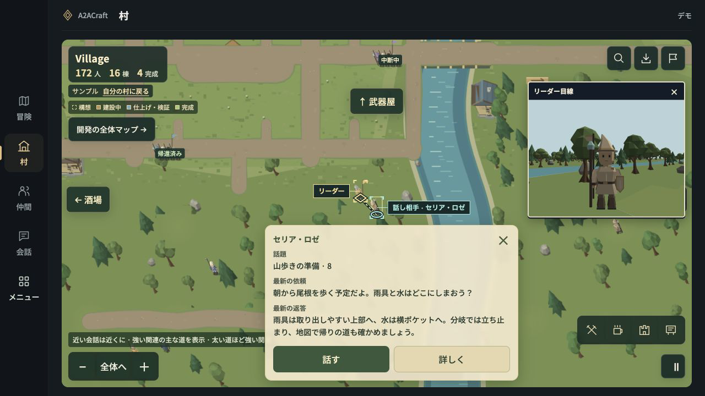

# A2ACraft

**会話から、世界が生まれる。**

[English](README.md) · **日本語**

A2ACraft（エーツーエークラフト）は、あなたとの会話と、仲間たちの仕事が世界をつくる構想です。会話から生まれた人々に出会い、仕事のつながりを眺めながら、次のアイデアを探します。

[](media/a2acraft-ja-45s.mp4)

[日本語で見る · 45秒](https://raw.githubusercontent.com/thinksyncs/a2acraft/main/media/a2acraft-ja-45s.mp4) · [英語で見る](https://raw.githubusercontent.com/thinksyncs/a2acraft/main/media/a2acraft-en-45s.mp4)

[日本語字幕](subtitles/ja.srt) · [English subtitles](subtitles/en.srt)

## Macで試す

[Apple Silicon用のTauri版0.4.23をダウンロード（ZIP）](https://github.com/thinksyncs/a2acraft/releases/download/v0.4.23-tauri/A2ACraft-0.4.23-Tauri-mac-arm64.zip) · [リリース情報とSHA-256](https://github.com/thinksyncs/a2acraft/releases/tag/v0.4.23-tauri)

対象はmacOS 13.5以降のApple Silicon Mac（Mシリーズ）です。CodexとNodeはアプリに同梱されています。

1. FinderでZIPをダブルクリックして展開し、`A2ACraft.app` を「アプリケーション」に移します。
2. 「アプリケーション」から **A2ACraft** を開きます。テスター向けのアドホック署名版で、Appleの公証は未取得です。「開発元を確認できない」と表示された場合は、ZIPのSHA-256を下記と照合し、配布元を信頼できる場合に限り、Appleの案内に沿ってこのアプリの起動を許可してください。[Appleの手順](https://support.apple.com/ja-jp/102445)
3. **Connect** を選び、案内に従ってChatGPTにログインします。A2ACraftに戻り、会話を開いてメッセージを送ると、Codexの返信が表示されます。

ZIPのSHA-256は `dacdf5f573a66b5b7ac0ec7dba09d9f0db7c79ed2e7d965411b9509c5fb9788e` です。

## 目指す体験

Agentたちは役割を分担し、見つけたことを伝え合い、成果をまとめます。仲間同士の会話から次のタスクが生まれ、その仕事が街を育てます。

- **スキルは装備に。** 道具や武器、呪文を選び、それぞれの仲間が力を発揮できるようにします。
- **リポジトリは家に。** プロジェクトが建物として形になり、仕事の進み具合が街に表れます。
- **テーマが世界の形に。** ズームアウトすると、近いテーマの街は近くに、異なるアイデアの街は遠くに。新しい協力から、次の街が生まれます。

動画では、村人のところまで歩いて話を聞き、仲間が持ちかけた依頼を地図上で引き受けます。地図を引いて集落を見渡したら、王城へ。王様から各隊の進み具合を聞けます。ゲーム内の架空の会話と依頼を使って撮影しました。

## 現在の試作版

A2ACraftは開発中のMVPです。街を歩き、マップを残したまま住民と会話し、仲間や装備を選べます。依頼の途中で行う選択が街の変化につながる、短く遊べる体験を目指して開発しています。



この画像は架空のサンプルデータを使ったフロントエンドです。A2ACraftのMacアプリのソースも掲載しています。

### Mac確認版

Apple Silicon向けにCodex 0.169.0を同梱し、アプリ専用のChatGPTログインを用意しました。接続せず保存済み会話を開く、下書きと地図位置を再起動後に復元する、読み取り専用の相談と会話専用フォルダ内の作業を切り替えることができます。専用Codex設定では外部ツール連携と既存シェルの起動設定を無効にしています。

取り込んだCodexの会話を開き、継続に必要な内容を準備できます。接続設定では、AIへの送信をせずに会話・ファイル作業の実行範囲を確認できます。

現在はテスター向けの確認版です。Developer ID署名とAppleの公証は未取得です。Apple Silicon MacでTauri版0.4.23を起動し、会話画面から送ったメッセージに実際のCodexが返信したことをテスターが確認しました。ファイル作業は今回の確認対象外です。Electron版では履歴の取り込みとChatGPTへの再接続を確認しています。[Electron版の検証状況](docs/preview-status.md)

Rust/Tauri版はMac標準のWebKitで地図と会話を表示します。地図・チャット・Codex接続の処理はElectron版と共通で、保存先はそれぞれ独立しています。Apple Silicon Macで `npm ci`、`npm run tauri:build` の順に実行するとTauri版を作れます。

- [Rust/Tauri版をビルドする](docs/tauri.md)
- [Electron版をビルドする](docs/electron.md)
- [初回起動と確認手順](docs/mac-first-start.md)
- [同梱ソフトウェアの通知](NOTICE.md)

```sh
npm ci
npm test
npm run dist:mac:arm64
```

Apple Silicon MacとNode.js 22以降を使用します。テスト用のアドホック署名付きアプリ・ZIP・DMGを生成します。APIキーや開発者証明書は含みません。

## 最初のクエストを一緒に考える

日常のどんな仕事を、小さな冒険に変えてみたいですか？ [アイデア・感想を送る](https://github.com/thinksyncs/a2acraft/issues/new)。公開Issueには架空の例を使い、個人の会話や認証情報を含めないでください。

このリポジトリにはアプリのソース、ビルド手順、テスト、紹介動画を掲載します。内部仕様、個人の会話、認証情報、ローカルの検証記録は含めません。プロジェクト全体へのオープンソースライセンスは設定していません。各同梱物の通知と素材のクレジットを確認してください。

[クレジットと素材の出典](CREDITS.md)
