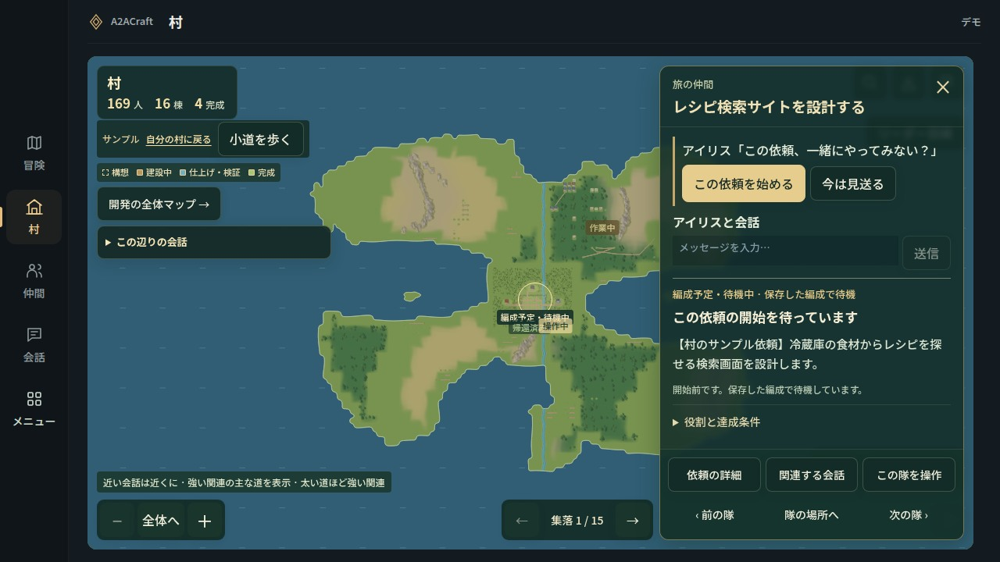
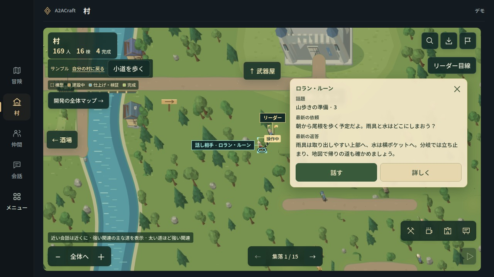

# A2ACraft

**会話から、世界が生まれる。**

[English](README.md) · **日本語**

A2ACraft（エーツーエークラフト）では、これまでの会話が村の住民の姿で現れます。何気ない一言が、新しい仲間との出会いや発明のきっかけになるかもしれません。パーティで依頼を始めると、一人が調べたことや考えた案は、次の担当に自動で引き継がれます。

[](https://thinksyncs.github.io/a2acraft/)

[日本語で見る · 45秒](https://thinksyncs.github.io/a2acraft/) · [英語で見る](https://thinksyncs.github.io/a2acraft/en/)

[日本語字幕](subtitles/ja.srt) · [English subtitles](subtitles/en.srt)

## Macで試す

0.4.25以降は、起動時の **Connect** か **設定 → 言語** で **English / 日本語** を切り替えられます。[英語の初回起動ガイド](docs/mac-first-start.en.md)にも、Codexへの接続と専用フォルダへのファイル作成の手順を載せています。

[Apple Silicon用のTauri版0.4.26をダウンロード（ZIP）](https://github.com/thinksyncs/a2acraft/releases/download/v0.4.26-tauri/A2ACraft-0.4.26-Tauri-mac-arm64.zip) · [リリース情報とSHA-256](https://github.com/thinksyncs/a2acraft/releases/tag/v0.4.26-tauri)

アプリ本体はmacOS 13.5以降のApple Silicon Mac（Mシリーズ）向けです。同梱の文書読み取り・音声用の一部部品はmacOS 14以降を必要とします。CodexとNodeはアプリに含まれます。

1. FinderでZIPをダブルクリックし、展開されたフォルダから `A2ACraft.app` を「アプリケーション」に移します。
2. 「アプリケーション」から **A2ACraft** を開きます。テスター向けのアドホック署名版で、Appleの公証は未取得です。「開発元を確認できない」と表示された場合は、ZIPのSHA-256を下記と照合し、配布元を信頼できる場合に限り、Appleの案内に沿ってこのアプリの起動を許可してください。[Appleの手順](https://support.apple.com/ja-jp/102445)
3. **Connect** を選び、案内に従ってChatGPTにログインします。A2ACraftに戻り、会話を開いてメッセージを送ると、Codexの返信が表示されます。
4. ファイル作成を試すには、新しい会話で入力欄の **＋** を開き、実行範囲を **作業（専用フォルダ内）** にします。「`hello.txt` に `Hello from A2ACraft` と書いて、保存場所を教えて」と送ります。Finderでそのファイルを開き、本文を確認します。

ZIPのSHA-256は `80d48e7a718106a28f59cc2a406eae25c2ceea946dbc2308de77f8b036853c79` です。

## 目指す体験

Agentたちは役割を分担し、見つけたことを伝え合い、成果をまとめます。仲間同士の会話から次のタスクが生まれ、その仕事が街を育てます。

- **スキルは装備に。** 道具や武器、呪文を選び、それぞれの仲間が力を発揮できるようにします。
- **リポジトリは家に。** プロジェクトが建物として形になり、仕事の進み具合が街に表れます。
- **テーマが世界の形に。** ズームアウトすると、近いテーマの街は近くに、異なるアイデアの街は遠くに。新しい協力から、次の街が生まれます。

動画では、村人の話を聞き、仲間が持ちかけた依頼を地図上で読みます。集落を見渡したら王城へ向かい、王様から各隊の進み具合を聞きます。ゲーム内の架空の会話と依頼を使って撮影しました。

## 現在の試作版

A2ACraftは開発中のMVPです。街を歩き、マップを残したまま住民と会話し、仲間や装備を選べます。依頼の途中で行う選択が街の変化につながる、短く遊べる体験を目指して開発しています。



この画像は架空のサンプルデータを使ったフロントエンドです。A2ACraftのMacアプリのソースも掲載しています。

### Mac確認版

Apple Silicon向けにCodex 0.169.0を同梱し、アプリ専用のChatGPTログインを用意しました。接続せず保存済み会話を開く、下書きと地図位置を再起動後に復元する、読み取り専用の相談と会話専用フォルダ内の作業を切り替えることができます。専用Codex設定では外部ツール連携と既存シェルの起動設定を無効にしています。

取り込んだCodexの会話を開き、継続に必要な内容を準備できます。接続設定では、AIへの送信をせずに会話・ファイル作業の実行範囲を確認できます。

現在はテスター向けの確認版です。Developer ID署名とAppleの公証は未取得です。Apple Silicon MacでTauri版0.4.23を起動し、会話画面から送ったメッセージに実際のCodexが返信したことをテスターが確認しました。ファイル作業は今回の確認対象外です。Electron版では履歴の取り込みとChatGPTへの再接続を確認しています。[Electron版の検証状況](docs/preview-status.md)

Tauri 0.4.24では、⌘Rで下書きを保存して画面を再読み込みできます。「ウィンドウ」メニューから表示の復帰・診断ができ、バックエンドが異常終了すると再起動を選べます。

Rust/Tauri版はMac標準のWebKitで地図と会話を表示します。保存先はそれぞれの版で独立しています。

## A2ACraftを開発する

両版の開発・配布元は [thinksyncs/a2acraft](https://github.com/thinksyncs/a2acraft) です。開発には `main` を使い、公開版を再現する場合は対応するリリースタグを使います。地図とチャットの共通画面は `public/`、共通のCodexバックエンドはリポジトリ直下、デスクトップ固有の実装は `src-tauri/` と `electron/` にあります。

```sh
git clone https://github.com/thinksyncs/a2acraft.git
cd a2acraft
npm ci
npm test
```

Apple Silicon MacとNode.js 22以降で、Tauri版は `npm run tauri:build`、Electron版は `npm run dist:mac:arm64` でビルドします。Tauri版にはRust、Cargo、Xcode Command Line Toolsも必要です。

- [Rust/Tauri版をビルドする](docs/tauri.md)
- [Electron版をビルドする](docs/electron.md)
- [初回起動と確認手順](docs/mac-first-start.md)
- [同梱ソフトウェアの通知](NOTICE.md)

## 最初のクエストを一緒に考える

日常のどんな仕事を、小さな冒険に変えてみたいですか？ [アイデア・感想を送る](https://github.com/thinksyncs/a2acraft/issues/new)。公開Issueには架空の例を使い、個人の会話や認証情報を含めないでください。

このリポジトリにはアプリのソース、ビルド手順、テスト、紹介動画を掲載します。内部仕様、個人の会話、認証情報、ローカルの検証記録は含めません。プロジェクト全体へのオープンソースライセンスは設定していません。各同梱物の通知と素材のクレジットを確認してください。

[クレジットと素材の出典](CREDITS.md)
