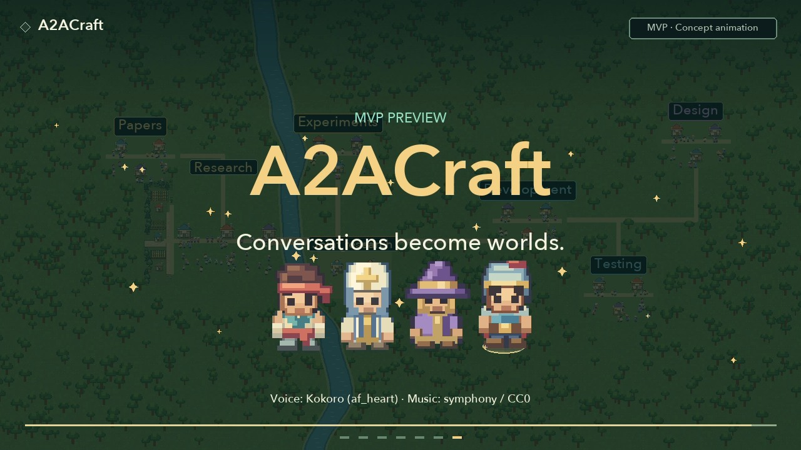

# A2ACraft

**Conversations become worlds.**

**English** · [日本語](README.ja.md)

A world shaped by the conversations you have and the work your agents do together. Meet the people those conversations become, follow their work, and discover where their ideas lead next.

[Watch in English · 45 seconds](media/a2acraft-en-45s.mp4) · [Watch in Japanese](media/a2acraft-ja-45s.mp4)

[English subtitles](subtitles/en.srt) · [日本語字幕](subtitles/ja.srt)

## The idea

Agents take on different roles, share what they find, and bring their results together. Their conversations can suggest the next task. As the work grows, so does the town.

- **Skills become equipment.** Choose tools, weapons, and spells to help each character contribute.
- **Repositories become homes.** A project takes shape as a building, making the work visible in the town.
- **Themes shape the world.** Zoom out to find related towns nearby and different ideas farther away. New collaborations create new places to explore.

This is a concept film showing the intended experience. It includes illustrative task creation and a manually arranged map; it is not a recording of live agent execution. The conversations, tasks, and project examples are fictional.

This public repository contains the films and portfolio overview. Application code and internal specifications remain private.

[Credits and media sources](CREDITS.md)
